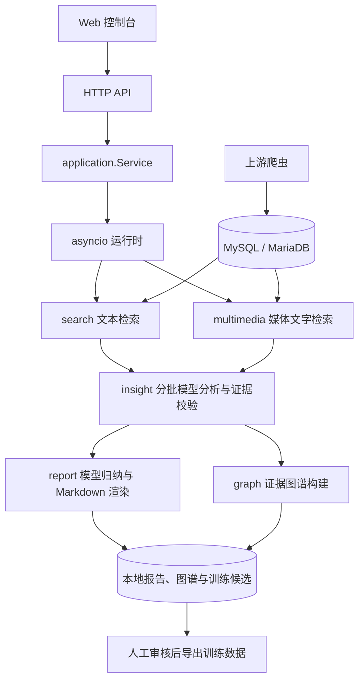

# 观潮舆情分析平台：项目技术说明与面试准备

## 一、项目定位

观潮是一个面向真实爬虫数据的舆情分析平台。系统从上游 `media_crawler` MySQL 数据库只读获取已采集内容，按照主题词检索和来源归一化后，调用兼容 Chat Completions 协议的大语言模型，生成逐条分析、结构化报告和证据图谱。

项目的核心目标不是简单输出一段模型文本，而是让每个结论都能回到原始来源：报告保留来源平台、URL、数据库名、表名和原始主键，模型输出必须通过本地 Schema、标签、引用和原文摘录校验。

## 二、技术栈

| 层次 | 技术/实现 | 作用 |
| --- | --- | --- |
| 运行环境 | Python 3.12+、Windows、本地单实例 | 项目运行与开发环境 |
| Web 服务 | FastAPI、Uvicorn、Starlette | ASGI 服务、类型化路由、静态页面、权限控制和 SSE |
| 请求校验 | Pydantic | 校验 HTTP 输入并生成 OpenAPI 请求结构 |
| 前端 | 原生 HTML、CSS、JavaScript | 控制台、检索、报告、图谱和配置页面 |
| 并发模型 | `asyncio`、协程任务、`asyncio.to_thread()` | 编排五类分析任务，隔离阻塞型同步调用 |
| 数据库 | MySQL/MariaDB、PyMySQL | 只读访问上游爬虫数据库 |
| 模型接入 | Python `urllib`、Chat Completions 兼容协议 | 不绑定具体模型厂商，支持本地或云端模型 |
| 数据校验 | Python 字典 Schema + 自定义校验器 | 约束模型字段、枚举、来源覆盖和证据摘录 |
| 存储 | JSON、JSONL、Markdown、本地目录 | 保存配置、日志、报告、图谱和训练候选 |
| 构建 | `pyproject.toml`、`uv` | 项目元数据、依赖和命令入口管理 |

Web 层使用 FastAPI + Uvicorn，模型和采集侧保留既有同步适配器；没有引入 ORM。MySQL 驱动作为可选依赖安装，可用 `uv sync --locked --extra mysql` 按锁文件复现依赖。

## 三、系统架构



主要包职责：

- `public_sentiment.application`：业务编排、生命周期、检索流程和结果落盘。
- `public_sentiment.collection`：数据库、RSS、内部文件和论坛数据采集，统一成来源协议。
- `public_sentiment.analysis`：LLM 客户端、提示词、Schema、输出校验和逐条分析。
- `public_sentiment.reporting`：报告 Markdown 渲染和证据图谱构建。
- `public_sentiment.runtime`：asyncio 事件循环、任务队列、协程生命周期和事件通知。
- `public_sentiment.infrastructure`：安全路径、本地 JSON/文本原子写入和结果索引。
- `public_sentiment.config`：默认配置、环境变量和数据库/LLM 参数校验。
- `public_sentiment.training`：人工审核样本导出为监督微调或领域续训数据。
- `public_sentiment.web`：FastAPI 应用工厂、APIRouter、Pydantic 请求模型、ASGI 鉴权中间件、SSE 和静态资源服务。

关键代码入口：`src/public_sentiment/runtime/tasks.py` 管理运行时和协程队列，`application/service.py` 编排业务流程，`analysis/client.py` 发起模型调用，`analysis/validation.py` 验证模型输出，`training/export.py` 导出训练数据。除首个完整路径外，其余路径均相对于 `src/public_sentiment/`。

## 四、一次分析流程

1. 用户在 Web 页面提交主题词和来源类型。
2. `Service.search()` 校验请求，读取配置并生成本次任务的配置快照。
3. `search` 和 `multimedia` 两个协程工作单元通过采集层查询数据。
4. 数据库适配器只执行参数化 SELECT，按字段映射转换为统一来源对象。
5. 系统按来源 ID 去重、按时间排序，并执行每表、每分支和全局样本上限。
6. `insight` 协程将来源按批次发送给模型；同步数据库和 HTTP 调用通过 `asyncio.to_thread()` 移出事件循环。
7. 本地校验模型返回的 JSON，检查字段完整性、情绪/风险枚举、来源引用、每条来源出现次数和连续原文摘录。
8. `report` 和 `graph` 任务并发生成 Markdown 报告和证据图谱。
9. 系统保存来源快照、模型分析、配置快照、报告、图谱和待审核训练样本。
10. Web 通过 SSE 推送状态变化，用户可以按 `report_id` 回查并使用数据库 locator 核对原始记录。

一次主题分析内部存在并发分支，但整个系统当前通过 `analysis_lock` 限制同时只运行一个主题分析。`POST /api/search` 会等待完整结果返回；SSE 推送应用状态、日志和图谱完成事件，不是流式输出模型 token，也没有独立持久化任务 ID 的后台提交接口。

## 五、协程化改造

原实现为每个功能启动一个独立操作系统进程，通过标准输入输出传递 JSON Lines。当前版本改成一个 asyncio 运行时和五个命名协程工作单元：`search`、`multimedia`、`insight`、`report`、`graph`。

运行时设计：

- `AsyncRuntime` 在后台线程维护一个 asyncio event loop，兼容在线程池执行的同步 FastAPI 路由与 `Service` 调用方式。
- 每个 `CoroutineWorker` 持有一个 `asyncio.Queue` 和一个 worker task。
- `submit()` 将任务放入对应队列，再通过事件循环中的 `asyncio.Future` 等待任务结果；同步调用边界使用 `run_coroutine_threadsafe()` 返回的 Future 接收结果。
- 采集、模型请求和报告函数当前仍是同步函数，因此由 `asyncio.to_thread()` 执行，避免阻塞事件循环。
- 分支通过 `asyncio.gather()` 并发编排；分支失败时取消同组等待任务，每个应用队列最多缓存 32 项。
- 超时请求不再接收或发布迟到结果，排队中的失效任务会跳过。停止时拒绝未完成请求，清空队列，等待当前阻塞调用收尾，再关闭事件循环和线程池。
- `to_thread()` 无法强制终止已运行的线程；停止耗时取决于当前数据库/模型调用的超时、批次和重试预算，不承诺立即取消外部请求。

这样改造的价值是减少多进程启动、IPC、环境变量继承和子进程日志管理的复杂度，同时保留独立任务队列、输入快照和独立状态。需要诚实说明：这不是所有底层 I/O 都变成原生异步，PyMySQL 和 `urllib` 仍然是同步库；当前是“协程任务编排 + 线程池承载阻塞调用”。

## 六、大语言模型设计

LLM 配置位于根目录 `.env`：

```dotenv
LLM_API_KEY=your-api-key
LLM_BASE_URL=http://127.0.0.1:8001/v1
LLM_MODEL=your-model-name
```

`LLM_BASE_URL` 填 API 根地址，客户端自动追加 `/chat/completions`。`config.json` 只保存非敏感参数，例如温度、最大 token、批大小和输出模式，不保存密钥。

模型调用采用两阶段：

- 逐条分析：生成摘要、观点、情绪、情绪理由、风险和原文摘录。
- 报告归纳：基于逐条分析生成概况、结论、总体风险、建议和局限。

程序不会直接信任模型输出，使用本地校验器限制：

- 输出必须是合法 JSON，字段和类型符合 Schema。
- 情绪只能是 `positive`、`neutral`、`negative`、`unknown`。
- 风险只能是 `high`、`medium`、`low`、`unknown`。
- 来源引用必须存在，且每条来源按协议出现。
- 原文摘录必须是输入标题或正文中的连续子串。
- 报告引用由程序组装，模型不能伪造 URL 或来源编号。

失败时只进行有限重试，最终校验失败就终止任务，不回退到第一版的词典或固定回复。

## 七、数据与安全设计

- 数据库账号建议使用 SELECT-only 权限，程序不建表、不迁移、不写入上游库。
- 表名、字段名通过标识符校验；关键词使用参数化 SQL 并转义 LIKE 通配符。
- 数据库密码和 LLM Key 只从环境变量读取，不写入 `config.json`、报告快照或训练数据。
- 本地文件写入使用临时文件替换，路径经过根目录约束，避免目录穿越。
- Web 默认监听 `127.0.0.1`；非本机监听必须设置管理员令牌，生产环境仍需 HTTPS、限流和审计。
- 报告中可能包含昵称、正文和原始 ID，实际部署时需要保护结果目录并做好脱敏。

## 八、训练数据准备

每次成功分析可以保存未审核候选样本，记录输入消息、模型输出、Schema、模型名、提示词版本和用量。人工审核后，使用：

```powershell
$env:PYTHONPATH = "$PWD\src"
.\.venv\Scripts\python.exe -m public_sentiment.training --data-dir . --format chat --output-dir training/sft
```

导出结果包含 `train.jsonl`、`validation.jsonl` 和 `manifest.json`。只有顶层候选和具体样本都标记为 `reviewed=true`，并且再次通过校验，才会进入训练集。项目只负责数据准备，不宣称已经完成模型训练；后续训练还需要明确基座模型、许可证、训练框架、显存和评估集。

## 九、面试回答模板

### 1. 一分钟介绍

“我做的是一个舆情分析平台，数据来源是上游爬虫写入的 MySQL。平台使用 Python 3.12、FastAPI 和 Uvicorn 提供 Web 控制台及 OpenAPI 文档，采集层只读查询数据库并统一来源结构，分析层接入兼容 Chat Completions 的大语言模型。模型输出不是直接展示，而是经过 JSON Schema、枚举、引用和原文摘录校验，最后生成可回溯到库表主键的 Markdown 报告和证据图谱。运行时采用 asyncio 协程编排五类任务，阻塞型 PyMySQL 和 urllib 调用通过 `asyncio.to_thread()` 执行。”

### 2. 为什么从多进程改协程

“原来的多进程方案隔离性强，但启动、IPC、环境变量继承和日志管理成本较高。这个项目主要是 I/O 等待和任务编排，不需要通过进程隔离来解决 CPU 密集型问题，所以改为单个 asyncio runtime 加多个协程队列。为了兼容已有同步业务代码，我保留同步 Service 接口，用线程安全的 Future 跨线程提交协程；底层同步数据库和 HTTP 调用放到 `asyncio.to_thread()`，避免阻塞事件循环。”

### 3. 如何防止模型胡说

“我没有把模型当作事实数据库。原始 URL、发布时间、数据库 locator、数量统计由程序保留或计算；模型只负责摘要、观点、情绪和风险解释。模型输出必须符合固定 Schema，引用必须对应真实来源，原文摘录必须能在输入文本中匹配。报告引用和图谱节点由程序根据校验后的结果生成，校验失败会重试，最终失败则终止任务。”

### 4. 项目难点

“难点主要有三个：第一是异构表字段映射和时间单位归一化；第二是模型输出的不确定性，需要设计约束协议和本地证据校验；第三是从来源到报告、图谱和训练样本的可追溯链路。我的处理方式是定义统一 source contract，用 locator 保存原始定位，用 report reference 贯穿分析、报告和图谱，并对配置、模型输出和训练数据分别做校验。”

### 5. 项目边界

“当前版本适合单实例、本地或内网验证，不是完整生产级分布式系统。它没有做 OCR、ASR、视频理解，也不是 CDC 全量同步；数据库查询是有上限的样本分析，不代表总体民意。后续可以把结果元数据迁移到 PostgreSQL，把全文检索换成 OpenSearch，引入任务队列、取消、幂等和评估体系。”

### 6. 是否属于 RAG 或多智能体系统

“它是检索后提供证据给模型的固定分析流水线。目前的检索是 MySQL 关键词查询，图谱由程序按来源和风险构建，没有向量库、Embedding 检索或 GraphRAG；五个应用也是固定职责的协程工作单元，不能仅因为调用了大模型就称为自主多智能体系统。”

### 7. 协程带来了多少性能提升

“我验证了并发分支、超时、重启和完整模拟业务链路，但还没有做同等数据量、同等模型下的压力和对比测试，所以不报未经测量的吞吐或延迟提升。改造目前明确减少了子进程和进程间消息传输，简化了运行时管理。实际耗时仍主要受数据库查询、模型推理、批次数和重试影响。”

### 8. 简历描述示例

> 开发基于 Python 3.12、MySQL 与 asyncio 的舆情分析平台，实现多源字段映射、只读检索、模型结构化分析、证据引用校验及报告/图谱归档；将五个子进程工作单元重构为协程队列，通过 gather 并发编排与 to_thread 适配同步 I/O，验证超时、错误恢复与启停重启；支持人工审核后的微调对话和领域语料导出。

请按你实际参与和掌握的部分调整个人职责。面试演示时不要把合成来源、本地模拟模型输出和历史词典报告当作当前真实模型效果，也不要把数据准备描述为已完成微调训练。

## 十、已验证内容

- `python -m compileall -q src` 通过。
- `node --check src/public_sentiment/static/app.js` 通过。
- 五个 asyncio 协程工作单元的启动、并发分支、输入隔离、异常回传、超时结果丢弃、停止与重启均通过。
- `Service.start_system()` 可以启动全部应用，`shutdown()` 可以关闭事件循环。
- 本地 HTTP 集成验证使用 8 条合成来源和本地模拟模型服务，覆盖页面/资源、分批分析、真实客户端 HTTP 请求、本地输出校验、报告/图谱落盘与回查。
- `json_object` 和 `json_schema` 模式、无来源拒绝、无效输出和 HTTP 503 的有限重试、失败后恢复均通过。
- 未审核候选被拒绝导出；模拟审核后成功导出 5 条对话样本和 8 条语料，密钥未写入候选。
- 论坛启停、整个系统关闭和重新启动、停止后历史报告保留通过。
- 模拟数据库连接验证了数据库默认分支、表结构诊断、并发采集、参数化 SQL、时间转换、locator 与报告/图谱链路；数据库错误不会回退到 demo。
- 静态资源、包导入和训练 CLI 入口可解析。
- 未连接真实数据库和模型服务时，不把端到端真实分析宣称为本地回归结果。

以上回归于 2026 年 10 月 22 日运行，数据与输出位于临时目录，未覆盖现有报告、数据库配置或密钥。35 个可导入模块和打包内的静态资源路径均通过检查；浏览器自动化、压力测试以及当前协程版本连接实际 MySQL 和真实模型的联合验收尚未执行。
